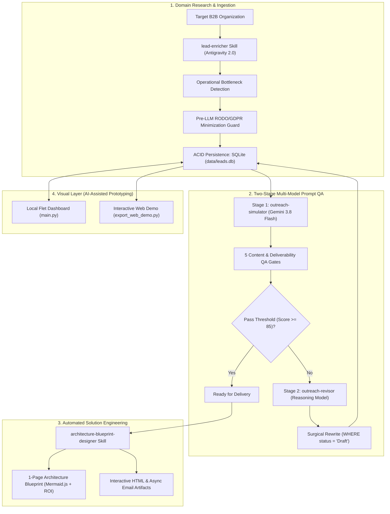

# B2B Lead Intelligence Agent & Workflow Automation Showcase

[](https://borkkiril.github.io/b2b-lead-intelligence-agent/)

[](https://www.python.org/)
[](https://antigravity.google)
[](https://aistudio.google.com/)
[-003B57.svg?logo=sqlite&logoColor=white)](https://www.sqlite.org/)
[](https://docs.pydantic.dev/)
[-success.svg?logo=githubactions&logoColor=white)](.github/workflows/ci.yml)
[](LICENSE)

> **An AI Agentic Workflow & Business Process Automation Showcase** built with **Antigravity 2.0** and **Gemini**. Demonstrates business process decomposition, two-stage adversarial prompt QA, deterministic RODO/GDPR data minimization, and automated technical solution architecture synthesis.

🚀 **[Experience the Live Interactive Demo](https://borkkiril.github.io/b2b-lead-intelligence-agent/)** — Browse verified leads across EU/UK/Ukraine, inspect plain-text email drafts, test client-side status and market filters, and view generated Architecture Solution Blueprints with calculated ROI models.

---

## 1. Core Focus & Methodology

This project showcases how modern **agentic AI workflows** and **business process analysis** replace brittle manual operational pipelines:

1. **Business Process Analysis & Bottleneck Identification:**
   Analyzes operational friction patterns across mid-market B2B companies (20–150 employees), focusing on ERP synchronization lag (Odoo, NetSuite, SAP Business One), manual invoice reconciliation, and warehouse management (WMS) desynchronization.
2. **Agentic Workflow Decomposition in Antigravity 2.0:**
   Decomposes monolithic multi-step tasks into specialized, modular agent skills (`.agent/skills/`) with explicit state contracts, anti-hallucination protocols, and schema enforcement.
3. **Two-Stage Multi-Model Prompt QA:**
   Decouples authoring from adversarial evaluation. Unsent drafts are evaluated across 5 Content & Deliverability QA Gates on high-throughput inference (**Gemini 3.8 Flash**), with surgical bottleneck rewriting executed by reasoning models on underperforming drafts.
4. **RODO / GDPR Data Minimization (Privacy Guardrails):**
   A deterministic pre-LLM sanitization layer (`core/rodo_compliance.py`) masks sensitive Polish identifiers (PESEL, National ID card numbers, personal telephone numbers) and blocks private consumer mailboxes (`@gmail.com`, `@wp.pl`, `@onet.pl`) under GDPR Article 5(1)(c) and Article 6(1)(f).
5. **Automated Technical Architecture Blueprints:**
   Translates confirmed operational bottlenecks into 1-page **Architecture Solution Blueprints** (`core/architecture_blueprint_generator.py`) featuring Mermaid.js data-flow diagrams, staging sandbox isolation guarantees, and calculated ROI models.

> [!NOTE]
> **UI Layer Note (AI-Assisted Prototyping):**  
> The lightweight local dashboard (`main.py`, Flet/SQLite) and the standalone interactive HTML export (`dist/index.html`) were prototyped using AI-assisted development (**Vibe-coding in Antigravity**) to visualize agent outputs, database telemetry, and status transitions without heavy external dependencies.

---

## 2. System Architecture & Agent Workflow



---

## 3. Modular Agent Skills (`.agent/skills/`)

The repository includes 4 clean, standardized agent skill specifications:

* [`.agent/skills/lead-enricher/SKILL.md`](file:///.agent/skills/lead-enricher/SKILL.md)  
  **Role:** B2B domain research & operational bottleneck identification. Researches target companies, extracts organizational pain signals (ERP migrations, manual AP/AR billing), and ingests structured records directly into SQLite.
* [`.agent/skills/outreach-simulator/SKILL.md`](file:///.agent/skills/outreach-simulator/SKILL.md)  
  **Role:** Stage 1 Fast Quality Gate (Gemini 3.8 Flash). Evaluates unsent email drafts against 5 survival gates (Spam/Deliverability, Subject Open Probability, 150-Char Preview Hook, Problem Resonance, and Micro-CTA Friction).
* [`.agent/skills/outreach-revisor/SKILL.md`](file:///.agent/skills/outreach-revisor/SKILL.md)  
  **Role:** Stage 2 Surgical Revision Agent (Reasoning Models). Analyzes drop-off telemetry from Stage 1, applies strict anti-AI cliché filters, and updates underperforming drafts directly in SQLite (`WHERE status = 'Draft'`).
* [`.agent/skills/architecture-blueprint-designer/SKILL.md`](file:///.agent/skills/architecture-blueprint-designer/SKILL.md)  
  **Role:** Solution Engineering Agent. Translates confirmed operational friction into comprehensive 1-page Architecture Solution Blueprints with Mermaid diagrams, staging sandbox specifications, and quantified ROI models.

---

## 4. Key Engineering Highlights

### Two-Stage Multi-Model Evaluation
* **Evaluator-Creator Decoupling:** Eliminates model self-preference bias by separating the evaluation gate from the authoring step.
* **Cost & Latency Optimization:** 85%+ of validation cycles execute on sub-second **Gemini 3.8 Flash** models, reserving deep reasoning compute strictly for targeted draft revisions.
* **Database State Protection:** Transactional SQL constraints (`WHERE status IN ('Draft', 'DRAFT')`) guarantee that sent leads and active communications remain strictly immutable.

### RODO / GDPR Data Minimization
* **Zero Leak Guarantee:** Masking rules catch Polish PESEL numbers (11 digits), ID cards (Dowód Osobisty), phone numbers, and regional consumer mailboxes (`@wp.pl`, `@onet.pl`, `@gmail.com`, `@interia.pl`).
* **Audit-Ready Classification:** Distinguishes consumer privacy risks from legitimate B2B corporate entities processed under GDPR Art. 6(1)(f).

### Rapid Sub-Second Test Suite
* **Deterministic Execution:** No network mocking or heavy browser drivers in test cycles. Schema validation, CRUD operations, RODO compliance filters, and UI mounting execute in **< 0.6 seconds**.

---

## 5. Repository Structure

```
b2b-lead-intelligence-agent/
├── .agent/skills/                     # Modular Agent Skill Specifications
│   ├── architecture-blueprint-designer/ # 1-page architecture blueprints & ROI models
│   ├── lead-enricher/                 # B2B domain research & operational pain discovery
│   ├── outreach-revisor/              # Stage 2: Surgical bottleneck revision
│   └── outreach-simulator/            # Stage 1: 5-Gate inbox QA (Gemini 3.8 Flash)
├── core/
│   ├── architecture_blueprint_generator.py # SOW specifications & Mermaid generators
│   ├── cache_manager.py               # Deterministic caching layer
│   ├── database.py                    # SQLite ACID layer with Pydantic v2 schemas
│   ├── notion_publisher.py            # Notion workspace payload formatter
│   └── rodo_compliance.py             # Pre-LLM PII masking (PESEL/Phone/Consumer emails)
├── ui/                                # Flet Desktop & Web Interface
│   ├── header.py                      # Real-time metrics counters & filters
│   ├── sidebar.py                     # Multi-dimensional navigation & search
│   ├── modals.py                      # Plain-text previews, blueprints & company dossiers
│   └── theme.py                       # Design tokens and visual theme
├── tests/
│   ├── test_system.py                 # SQLite, RODO compliance & UI smoke tests (<0.6s)
│   └── verify_leads_compliance.py     # Schema and compliance verification
├── docs/
│   └── adr/                           # Architecture Decision Records (Nygard format)
│       ├── 0001-decouple-agent-enrichment-from-python-ui.md
│       ├── 0002-two-stage-multi-model-outreach-qa.md
│       └── 0003-rodo-compliance-and-data-minimization.md
├── .github/workflows/
│   └── ci.yml                         # Automated test suite & GitHub Pages deployment
├── CLAUDE.md                          # AI Governance & Agent Engineering Guidelines
├── export_web_demo.py                 # Standalone GitHub Pages showcase generator
├── seed_demo_data.py                  # Safe 3-company mock seeder (.example.com)
├── main.py                            # Flet application entry point
├── Launch-App.sh                      # Shell launch script
├── requirements.txt                   # Clean production dependencies
└── LICENSE                            # MIT License
```

---

## 6. Quick Start & Verification

### 1. Clone & Set Up Environment
```bash
# Clone the repository
git clone https://github.com/borkkiril/b2b-lead-intelligence-agent.git
cd b2b-lead-intelligence-agent

# Create and activate virtual environment
python3 -m venv .venv
source .venv/bin/activate

# Install dependencies
pip install -r requirements.txt
```

### 2. Populate Safe Demo Data
```bash
# Seeds 3 safe fictitious companies (.example.com) into SQLite
python seed_demo_data.py --reset
```

### 3. Run Automated Tests
```bash
# Runs full test suite (SQLite integrity, CRUD lifecycle, RODO guard, UI mount)
python -m unittest discover tests -v
```

### 4. Launch Local Dashboard or Web Demo
```bash
# Run local Flet application
python main.py

# Or launch local web view on port 8550
python main.py --web

# Regenerate standalone GitHub Pages live demo (dist/index.html)
python export_web_demo.py
```

---

## License

This project is licensed under the [MIT License](LICENSE) — Copyright (c) 2026 Kiril Borysenko.
